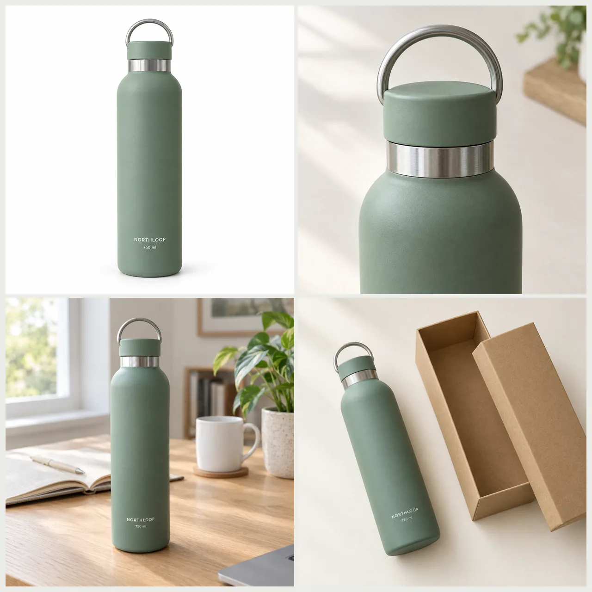
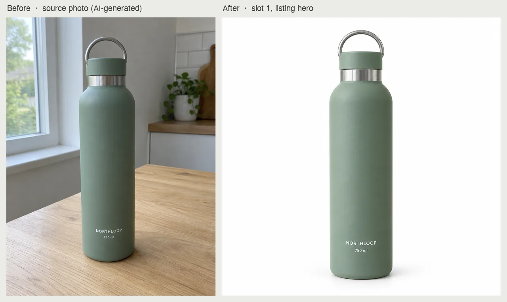

# Ecommerce Product Images Skill

[English](./README.md) | [简体中文](./README.zh-CN.md) | 日本語

> 👉 こちらもどうぞ [AI Product Photography Skill](https://github.com/beatra-ai/ai-product-photography-skill)

実際の商品写真と確定済みの SKU 情報から、メイン画像、訴求画像、使用シーン、サイズ表示、同梱内容がそろった EC 画像セットを作成。Claude Code、Cursor、Codex、Windsurf、Cline、OpenClaw のどれからでもそのまま使えます。

> [!IMPORTANT]
> 生成には [Beatra](https://beatra.ai?utm_source=github&utm_medium=flagship&utm_campaign=ecommerce-product-images-skill) アカウントが必要で、クレジットを消費します。スキル自体のインストールは無料です。

| 項目 | 内容 |
| --- | --- |
| **できること** | 実商品写真と確定済みSKU情報から、メイン画像、訴求画像、使用シーン、サイズ、同梱内容まで統一して制作します。 |
| **モデル** | Qwen Image 2.0 Fast、Qwen Image 3.0、Qwen Image 3.0 Pro、Wan Image 2.7 Fast、Qwen Image 2.0 Pro、Wan Image 2.7 Pro、GPT Image 2.5 Flare、GPT Image 2.5 Sunburst、GPT Image 2、MiniMax Image 01 Live |
| **動作要件** | Python 3.10 以上と、`SKILL.md` を読み込めるエージェント |
| **費用** | インストールは無料。生成のたびに Beatra アカウントのクレジットを消費しますが、課金されるのは、その生成を明示的に依頼したとき、または確認カードを承認したときだけです。 |
| **対応エージェント** | Claude Code、Cursor、Codex、Windsurf、Cline、OpenClaw |

<p align="center"></p>

*架空の NORTHLOOP 750 ml 保温ボトル（マットセージ）の商品ページ用 4 枚セット：白背景のメイン画像、キャップと口元のディテール、デスクでの使用シーン、同梱内容。すべて同じ元の商品写真から作成。Beatra AI で生成。*

| Skill | Entry point | Version |
| --- | --- | --- |
| [`ecommerce-listing-image-set`](skills/ecommerce-listing-image-set) | [SKILL.md](skills/ecommerce-listing-image-set/SKILL.md) | 0.3.0 |

このリポジトリは [beatra-ai/beatra-skills](https://github.com/beatra-ai/beatra-skills/tree/main/skills/ecommerce-listing-image-set) から自動的に公開されています。問題の報告はそちらへお願いします。

## インストール

[`skills`](https://skills.sh) CLI を使う場合：

```bash
npx skills add beatra-ai/ecommerce-product-images-skill
```

Claude Code プラグインとして：

```bash
claude plugin marketplace add beatra-ai/ecommerce-product-images-skill
claude plugin install ecommerce-listing-image-set@ecommerce-product-images-skill
```

Codex プラグインとして：

```bash
codex plugin marketplace add beatra-ai/ecommerce-product-images-skill
codex plugin add ecommerce-listing-image-set@ecommerce-product-images-skill
```

GitHub Copilot CLI プラグインとして：

```bash
copilot plugin marketplace add beatra-ai/ecommerce-product-images-skill
copilot plugin install ecommerce-listing-image-set@ecommerce-product-images-skill
```

Gemini CLI 拡張機能として：

```bash
gemini extensions install https://github.com/beatra-ai/ecommerce-product-images-skill
```

GitHub CLI を使う場合：

```bash
gh skill install beatra-ai/ecommerce-product-images-skill ecommerce-listing-image-set
```

または、このリポジトリをクローンして `skills/ecommerce-listing-image-set` を次の場所にコピーします：Claude Code は `~/.claude/skills/`、Cursor は `~/.cursor/skills/`、Codex は `~/.agents/skills/`、Windsurf は `~/.codeium/windsurf/skills/`、Cline は `~/.cline/skills/`、OpenClaw は `~/.openclaw/skills/`。

または、次の文をエージェントに貼り付けてください：

```text
https://github.com/beatra-ai/ecommerce-product-images-skill から ecommerce-listing-image-set スキル（フォルダ skills/ecommerce-listing-image-set）をインストールし、その SKILL.md に従って私の Beatra アカウントに接続してください。
```

## 作例

<p align="center"></p>

*キッチンテーブルに置いた架空の NORTHLOOP ボトルの元写真（デモ用に AI 生成）と、そこから作った白背景のメイン画像。形、色、ラベル文字は元のまま。Beatra AI で生成。*

エージェントへの依頼例：

```text
キッチンテーブルに置いた NORTHLOOP ボトルのスマホ写真があります（./bottle-table.jpg）。これから商品ページ用の画像セットを作って：まず白背景のメイン画像、続けてキャップと口元のディテール、デスクでの使用シーン、同梱内容。形、マットセージの色、ラベルの文字は変えないで。
```

プロンプト：

```text
[before] Casual smartphone photo taken by a small online seller of their own product: one insulated stainless steel water bottle standing upright on a light oak kitchen table next to a window. The bottle has a matte sage green powder-coated body, a straight cylindrical shape with softly rounded shoulders, a brushed stainless steel neck ring, and a matte sage green screw cap with a short brushed steel carry loop on top. On the front of the body, printed in small white bold sans-serif capital letters, is the exact word "NORTHLOOP", and directly below it in smaller white capitals the exact text "750 ml". Nothing else is written anywhere on the bottle. The bottle is shown front-on at a slight angle, a little off center, with a kitchen wall softly out of focus behind it. Plain daylight from the window, slightly flat phone-camera colors, mild noise, honest amateur product snapshot. Photorealistic, no people, no other text or logos anywhere. ||| [after] Create slot 1, the clean product hero for a marketplace listing. Image 1 is the exact verified SKU. Preserve its matte sage green body, straight cylindrical shape with softly rounded shoulders, brushed stainless steel neck ring, matte sage green screw cap with brushed steel carry loop, and the small white printed text "NORTHLOOP" with "750 ml" directly below it, exactly as they appear in image 1, with no other text on the bottle. Show the single bottle upright, centered, front-on at eye level with the text facing the camera, on a pure white seamless background with a soft contact shadow, the bottle filling about three quarters of the frame height. Soft diffused daylight from the upper left, gentle natural shadows, a calm muted palette of sage, warm white, and light oak, crisp photorealistic product focus, the bottle as the clear focal point of the frame.
```

## 技術仕様と出力上限

2026-10-18 時点。最新の一覧：https://docs.beatra.ai/ja/docs/models

- **アップロード** — 1 ファイルあたり最大 100 MB。下記の各モデルの入力制限も適用されます
- **画像から画像** — 10 モデル（Qwen Image 2.0 Fast、Qwen Image 3.0、Qwen Image 3.0 Pro、Wan Image 2.7 Fast、Qwen Image 2.0 Pro、Wan Image 2.7 Pro、GPT Image 2.5 Flare、GPT Image 2.5 Sunburst、GPT Image 2、MiniMax Image 01 Live）／PNG／1 リクエストあたり最大 4 枚／キャンバス最大 16.8 MP
  - 16.8 MP（4K ティア）：GPT Image 2.5 Flare、GPT Image 2.5 Sunburst、GPT Image 2（1 リクエストにつき 1 枚）
  - 入力画像：1 リクエストあたり最大 4 枚、各 10〜20 MB／BMP、GIF、JPEG、PNG、TIFF、WEBP
- **画像編集** — 6 モデル（Qwen Image 2.0 Fast、Qwen Image 3.0、Qwen Image 3.0 Pro、Wan Image 2.7 Fast、Qwen Image 2.0 Pro、Wan Image 2.7 Pro）／PNG／1 リクエストあたり最大 4 枚／キャンバス最大 4.2 MP
  - 4.2 MP（2K ティア）：Qwen Image 2.0 Fast、Qwen Image 3.0、Qwen Image 3.0 Pro、Wan Image 2.7 Fast、Qwen Image 2.0 Pro、Wan Image 2.7 Pro（1 リクエストあたり最大 4 枚）
  - 入力画像：1 リクエストあたり最大 4 枚、各 10〜20 MB／BMP、GIF、JPEG、PNG、TIFF、WEBP

## 得られるもの

- **完全な商品ギャラリー設計** — メイン、訴求、詳細、使用シーン、サイズや着用感、同梱内容を、同じ情報の繰り返しなく構成します。
- **1SKUに1つの視覚方向** — どの画像でも同じ商品に見えるよう、色、素材、柄、比率、ブランド表現をセット全体でそろえます。

## 活用シーン

- **マーケットプレイス新規出品** — Amazon、Etsyなどへ、メインから詳細まで順序立てた画像を準備します。
- **Shopify商品ギャラリー** — 商品、利点、サイズ、使用場面、同梱内容をまとまりのあるセットで示します。
- **既存カタログ更新** — 現在の商品情報と写真を基に、統一感のない旧画像を一式で整えます。

## よくある質問

### どの画像をセットに含められますか？

出品に合わせて、メイン、訴求、詳細、使用シーン、サイズや着用感、パッケージ・同梱内容を選べます。

### 確定した商品情報は必要ですか？

はい。対象の商品と仕様、見える特徴、寸法、同梱内容を確認してから設計します。

### セットの一枚だけを調整できますか？

はい。採用した商品と視覚方向を基準に、選択画像へ集中した修正を行えます。

## 更新とセキュリティ

2026 年 10 月のリリース以降、このスキルに自動更新機能はありません。インストールしたファイルだけを実行し、
自動的に置き換えることはありません。更新はインストールに使ったツール（`npx skills update ecommerce-listing-image-set` または
`gh skill update ecommerce-listing-image-set`）で行ってください。詳細はスキル内の `references/updates-and-security.md` を参照してください。

## ライセンス

[MIT-0](LICENSE)：商用を含め、自由に使用・改変・再配布できます。クレジット表記は不要です。ClawHub 上のこれらのスキルと同じ条件です。

## リンク

- ウェブサイト — https://beatra.ai?utm_source=github&utm_medium=flagship&utm_campaign=ecommerce-product-images-skill
- ドキュメント — https://docs.beatra.ai?utm_source=github&utm_medium=flagship&utm_campaign=ecommerce-product-images-skill
- コンソール — https://console.beatra.ai
- AI エージェント向け — https://beatra.ai/llms.txt （インデックス）· https://beatra.ai/llms-full.txt （全スキルを 1 ファイルに）
